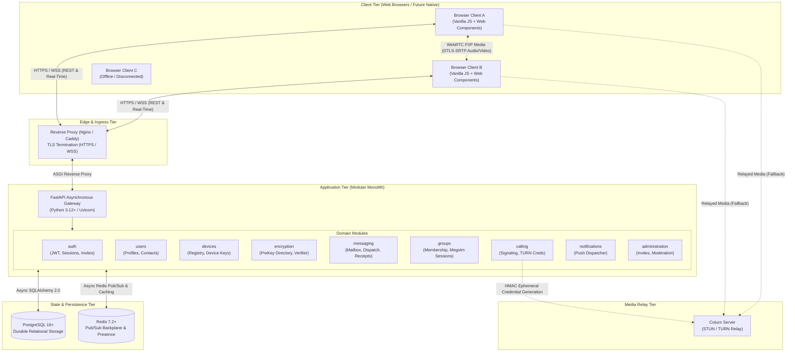
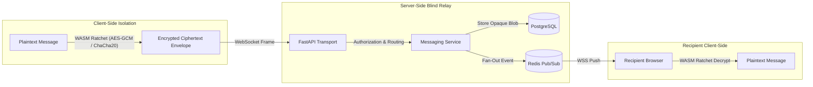
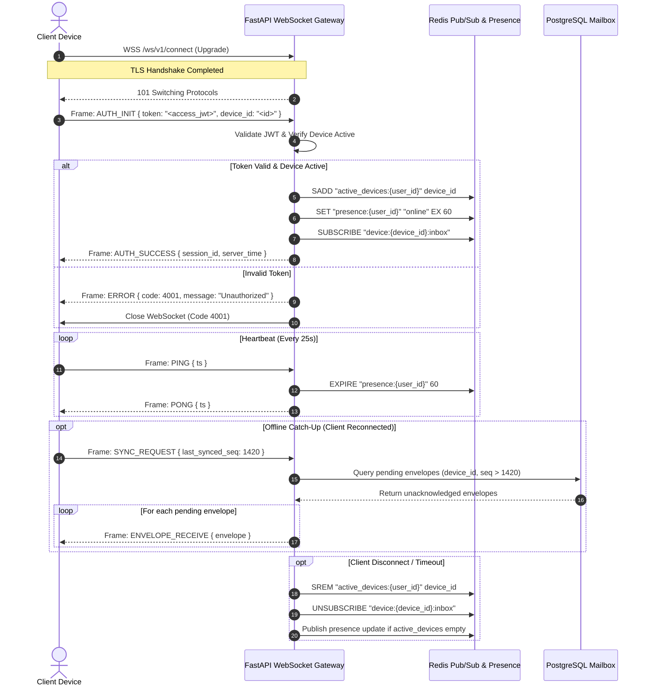
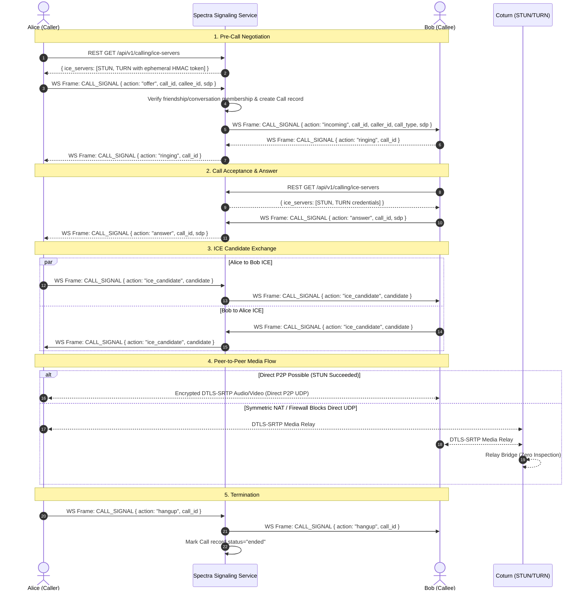
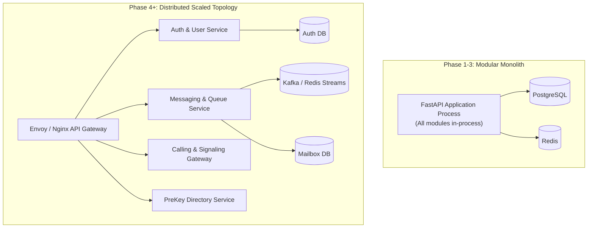

# Project Spectra: System Architecture Blueprint

> **Document Status**: Approved Baseline (Phase 0)  
> **Authors**: Principal Software Architect & Technical Lead  
> **Target Audience**: Core Engineering Team, Security Auditors, Systems Engineers

---

## 1. Architectural Vision & High-Level System Topology

Project Spectra is an end-to-end encrypted (E2EE), real-time, privacy-first communication platform. The system is designed to provide the fluid, responsive usability of modern consumer messaging apps (such as Telegram) while maintaining the mathematical security guarantees of high-assurance encrypted protocols (such as Signal and Matrix Olm/Megolm).

### 1.1 Core Topology Diagram



---

## 2. Modular Monolith Architecture

Spectra begins as a **Modular Monolith** to maximize development velocity, maintain strict transactional boundaries, and eliminate the premature operational complexities of distributed microservices (distributed transactions, network partitions, cascading latency).

### 2.1 Backend Directory Structure & Domain Modules

The backend is partitioned into self-contained domain packages under `backend/app/modules/`. Each module adheres to a strict four-layer architecture:

```
backend/app/
├── core/                         # Cross-cutting foundational infrastructure
│   ├── config.py                 # Pydantic v2 settings (env variables)
│   ├── database.py               # Async SQLAlchemy engine & session factory
│   ├── redis.py                  # Async Redis connection pool & pub/sub client
│   ├── security.py               # Password hashing (Argon2id), JWT issuance
│   └── exceptions.py             # Global domain exception handlers
├── modules/
│   ├── auth/                     # Authentication & Access Control
│   │   ├── api/                  # REST routers (/api/v1/auth/*)
│   │   ├── schemas.py            # Pydantic request/response schemas
│   │   ├── models.py             # SQLAlchemy entities (User, Session, Invite)
│   │   ├── services.py           # Domain business logic & token rotation
│   │   └── repository.py         # DB query abstractions
│   ├── users/                    # User profile, settings, & contact lists
│   ├── devices/                  # Device identities, sessions, & tracking
│   ├── encryption/               # PreKey directory & public key verification
│   ├── messaging/                # Opaque envelope mailbox & dispatch queue
│   ├── groups/                   # Group memberships, roles, & sender key fan-out
│   ├── calling/                  # WebRTC signaling router & Coturn credentials
│   ├── notifications/            # Ephemeral alerts & Web Push dispatch
│   └── administration/           # Invite code generation & server maintenance
├── websockets/                   # Real-time WebSocket connection manager & router
│   ├── connection_manager.py     # Local connection map & heartbeat manager
│   ├── router.py                 # Frame routing to domain services
│   └── redis_subscriber.py       # Distributed Redis listener for multi-worker fanout
└── main.py                       # FastAPI application factory & lifecycle mounts
```

### 2.2 Module Responsibilities & Architectural Boundaries

| Module | Core Responsibility | Persistence Entities Owned | In-Memory / Ephemeral Dependencies |
| :--- | :--- | :--- | :--- |
| **`auth`** | User registration (invite-enforced), credential verification, JWT generation, and refresh token rotation with family revocation. | `User`, `Session`, `Invite` | Token blacklist, failed login rate limits. |
| **`users`** | Profile management, display names, avatar hashes, and contact relationships. | `UserProfile`, `Contact` | User search indexes. |
| **`devices`** | Device identity registration, platform tracking, active session mapping, and device revocation. | `Device` | Active connection status per device. |
| **`encryption`** | Public pre-key directory (Identity Keys, Signed Pre-Keys, One-Time Pre-Keys). Cryptographic signature verification. | `DevicePrekeyBundle`, `DeviceOneTimePrekey` | Pre-key replenishment alarms. |
| **`messaging`** | Untrusted store-and-forward mailbox for encrypted envelopes. Delivery receipts, sequence counters, and message acknowledgments. | `MessageEnvelope`, `Attachment` | Transient delivery queues, sequence generators. |
| **`groups`** | Group conversation metadata, membership registries, role-based authorization, and group avatar storage. | `Conversation`, `ConversationMember` | Active group participant caches. |
| **`calling`** | WebRTC signaling exchange (SDP offer/answer, ICE candidates) and Coturn ephemeral credential issuance. | `Call`, `CallParticipant` | Active call state machines, timeout timers. |
| **`notifications`**| Web push notification formatting and delivery alerts. | `PushSubscription` | Pending notification queues. |
| **`administration`**| Server configuration, invite batch generation, system health reporting, and audit logs. | `AuditLog`, `SystemConfig` | Global rate limit rules. |

### 2.3 Strict Separation of Concerns & The "Blind Relay" Principle

To guarantee privacy, the server is architected strictly under the **Untrusted Blind Relay Principle**:
1. **API / Transport Layer**: Handles transport deserialization, schema validation, rate-limiting, and token authentication.
2. **Domain Service Layer**: Enforces access control (e.g., "Is Device $A$ a member of Group $G$?"), validates sequence monotonicity, and updates metadata.
3. **Cryptographic Isolation**: The server **never** decrypts message payloads, never holds user or device private keys, and never inspects media attachments. It stores and routes opaque ciphertexts with associated public keys and nonces.
4. **Persistence Layer**: Relational operations in PostgreSQL manage durable state; Redis handles ephemeral presence and pub/sub distribution.



---

## 3. Real-Time Communication & Messaging Architecture

### 3.1 WebSocket Lifecycle & Connection Management

Real-time interaction occurs over a single, multiplexed, bidirectional WebSocket connection per active client device.



### 3.2 Redis Pub/Sub Multi-Worker Backplane

To allow horizontal scaling across multiple ASGI worker processes and multiple server containers:
- Each connected device is bound to an ASGI task listening to a dedicated Redis channel: `device:{device_id}:inbox`.
- When an incoming message arrives at Worker 1 destined for a device connected to Worker 2, Worker 1 publishes the envelope to `device:{target_device_id}:inbox`.
- Worker 2 receives the Redis pub/sub event and pushes the frame down the local WebSocket to the target device.

---

## 4. WebRTC Voice & Video Architecture

Voice and video calling in Spectra uses standard WebRTC with DTLS-SRTP encryption, ensuring that audio/video streams travel peer-to-peer (P2P) or through an encrypted relay without server-side decryption.

### 4.1 Signaling Protocol Architecture

WebRTC signaling is transmitted over the existing duplex WebSocket channel. The server acts as a stateful signaling switch:



### 4.2 Coturn STUN/TURN Integration & Ephemeral Authentication

Direct peer-to-peer connection fails in approximately 15–25% of real-world connections due to symmetric NATs (common in mobile 4G/5G carriers) or strict enterprise firewalls.
- **Coturn** provides standard RFC 5766 TURN relaying and RFC 5389 STUN services.
- **Ephemeral Credentials (RFC 7635)**: The backend generates short-lived TURN credentials using a shared secret HMAC-SHA1 algorithm:
  $$\text{Username} = \tau_{\text{expiry}} : \text{user\_id}$$
  $$\text{Password} = \text{Base64}\Big(\text{HMAC-SHA1}\big(K_{\text{turn\_secret}}, \text{Username}\big)\Big)$$
- Credentials expire after a configured lifetime (e.g., 3,600 seconds), preventing unauthorized relay abuse.

---

## 5. Frontend Architecture (Vanilla JavaScript Web Client)

To fulfill the web-first, framework-free mandate without sacrificing code maintainability or component modularity, the frontend employs a modern, native web architecture:

### 5.1 Architecture Stack & Organization

```
frontend/src/
├── app.js                        # Main application bootstrap & routing
├── config.js                     # Runtime configuration & API endpoints
├── assets/                       # Static SVGs, audio chimes (ringtone, ping)
├── crypto/                       # Client-side cryptographic subsystem
│   ├── wasm_loader.js            # Asynchronous loader for vodozemac WASM
│   ├── identity_manager.js       # Ed25519/Curve25519 identity key generator
│   ├── session_store.js          # IndexedDB abstraction for Olm ratchet sessions
│   ├── group_crypto.js           # Megolm outbound/inbound group session manager
│   └── attachment_crypto.js      # AES-256-GCM streaming file encryptor/decryptor
├── services/                     # Network & protocol service layers
│   ├── api_client.js             # Fetch wrapper with auto-refresh token retry
│   ├── websocket_client.js       # Auto-reconnecting WebSocket with frame dispatch
│   └── webrtc_manager.js         # RTCPeerConnection wrapper, ICE & media tracks
├── store/                        # Reactive client state management
│   ├── reactive_store.js         # Lightweight Signal / EventTarget reactive store
│   ├── indexed_db.js             # Dexie/IDB wrapper for message & contact cache
│   └── slices/                   # Slices: auth, chats, messages, calls, presence
└── components/                   # Vanilla JS Custom Web Components
    ├── auth-view.js              # Registration & login forms
    ├── chat-sidebar.js           # Conversation list with unread counters
    ├── chat-window.js            # Message timeline with virtualized scrolling
    ├── message-bubble.js         # Single message renderer (text, media, status)
    ├── call-overlay.js           # WebRTC active call overlay & media controls
    └── common/                   # Reusable components (avatar, modal, tooltip)
```

### 5.2 Reactive Store Pattern without Frameworks

The client avoids monolithic virtual DOM libraries by implementing a native **Observer / Reactive Store** pattern using the browser's built-in `EventTarget`:

```javascript
// Lightweight Reactive Store Pattern
class SpectraStore extends EventTarget {
  constructor(initialState) {
    super();
    this._state = new Proxy(initialState, {
      set: (target, prop, value) => {
        target[prop] = value;
        this.dispatchEvent(new CustomEvent('statechange', { detail: { prop, value } }));
        return true;
      }
    });
  }

  get state() { return this._state; }
  setState(updates) { Object.assign(this._state, updates); }
}
```

Components inherit from `HTMLElement` (Standard Web Components) and subscribe to store mutations via `connectedCallback` and `disconnectedCallback`.

---

## 6. Critical Architecture Questions & Evaluated Solutions

This section explicitly answers the 9 critical architectural inquiries mandated for Phase 0.

### 6.1 Question 1: How should multi-device encryption work?

**Resolution**: Cryptographic identity is bound to a **Device**, not a User.
- A user account acts as a parent directory of registered devices ($D_1, D_2, \dots, D_n$).
- Each device generates its own distinct `IdentityKeyPair` (Ed25519 / Curve25519), `SignedPreKey`, and a set of `OneTimePreKeys`.
- When Alice ($A_1$) sends a message to Bob (who owns devices $B_1, B_2$):
  - Alice's client queries the backend prekey directory for all active devices of Bob ($B_1, B_2$) **and** all other active devices of Alice ($A_2$).
  - Alice's client performs **Client-Side Pairwise Fan-Out**: it encrypts the message payload $M$ independently under the active Double Ratchet session for each target device:
    $$\text{Payload} \to \big[ \text{Enc}_{A_1 \to B_1}(M),\; \text{Enc}_{A_1 \to B_2}(M),\; \text{Enc}_{A_1 \to A_2}(M) \big]$$
  - Alice uploads this batch of envelopes to the server in a single atomic request.
  - Device $A_2$ (Alice's laptop) receives its envelope, ratchets forward, and decrypts the message, ensuring seamless multi-device history synchronization without server-side decryption.

### 6.2 Question 2: How should encrypted group messaging work?

**Resolution**: The **Sender Keys / Megolm Ratchet Architecture** is selected over pairwise mesh fan-out.
- **The Problem with Pairwise Mesh**: In a group of $N = 500$ members, a single message would require $N-1$ separate cryptographic encryptions on a client browser and $N-1$ distinct payloads uploaded over the mobile network, resulting in severe bandwidth throttling and CPU exhaustion ($O(N)$ client overhead).
- **Sender Keys (Megolm Model)**:
  1. Each group participant device maintains an **Outbound Group Session** (a symmetric ratchet initialized with a random 256-bit seed).
  2. The device shares this Outbound Group Session key (and current ratchet counter) with all group members via their existing **1:1 Pairwise Double Ratchet** channels.
  3. When sending a message to the group:
     - The device advances its outbound ratchet by one step, deriving an ephemeral message encryption key.
     - The device encrypts the message **once** using AES-256-GCM / ChaCha20-Poly1305.
     - The device uploads **one single ciphertext** to the server with the group ID and session ID.
     - The server fans out the *identical* ciphertext to all registered devices in the group ($O(1)$ client upload).
  4. Each receiving device uses its stored **Inbound Group Session** for that sender to ratchet forward and decrypt the payload.
- **Group Key Rotation & Post-Compromise Security**:
  - Whenever a member leaves or is removed from the group, all remaining members immediately invalidate and discard their current Outbound Group Sessions.
  - New session keys are generated and distributed strictly to the remaining authorized members via pairwise 1:1 ratchets. The removed member cannot decrypt subsequent messages.

### 6.3 Question 3: How will offline message delivery work without server-side plaintext access?

**Resolution**: The server functions as an **Untrusted Store-and-Forward Mailbox**.
- The server maintains a `message_envelopes` table. Each record holds an opaque encrypted blob addressed to a specific `recipient_device_id`.
- The server has no knowledge of message contents, ratchet states, or keys.
- If a target device is offline, the envelope remains persisted in PostgreSQL.
- Upon reconnecting, the device executes an authenticated synchronization handshake (`SYNC_REQUEST`), pulling all queued envelopes where `sequence_id > last_acknowledged_sequence`.
- Once the client decrypts and verifies the message into its local IndexedDB, it sends a `MESSAGE_ACK`.
- **Retention & Pruning**: Envelopes are pruned from the server database once acknowledged by all recipient devices, or upon reaching a server-wide expiry TTL (default: 30 days).

### 6.4 Question 4: How will message synchronization work?

**Resolution**: **Monotonic Per-Device Sequence IDs + Client-Side Control Frames**.
- Each device queue in the database maintains a strictly increasing, 64-bit integer `sequence_id`.
- When a client receives envelopes, it stores them in local IndexedDB.
- **Message Edits and Deletions**:
  - Edits and deletions are transmitted as encrypted **Control Envelopes**.
  - An edit envelope contains an encrypted JSON payload: `{ action: "EDIT", target_message_id: "uuid", new_body: "...", timestamp: 1718000000 }`.
  - The receiving client decrypts the envelope, verifies that the author of the edit matches the author of the original message, and updates the local IndexedDB record.
  - The server never observes edit histories or deletion reasons.

### 6.5 Question 5: How should WebRTC signaling be implemented?

**Resolution**: Multiplexed WebSocket JSON framing with a strict finite-state machine (FSM).
- WebRTC signaling messages (`offer`, `answer`, `ice_candidate`, `ringing`, `reject`, `hangup`) are formatted as JSON envelopes and routed over the established user WebSocket.
- The backend `calling` module tracks active call sessions in Redis, validating that callers can only signal authorized contacts and managing ring timeouts.
- Signals are delivered directly to the callee's active devices via Redis pub/sub.

### 6.6 Question 6: When is a TURN relay necessary?

**Resolution**: Automatically negotiated by the WebRTC ICE agent when direct P2P connectivity fails.
- Direct P2P via STUN succeeds when at least one party has a public IP or when NATs are Full Cone, Address-Restricted, or Port-Restricted.
- TURN relay is strictly mandatory when:
  1. Both peers are behind **Symmetric NATs** (port allocations change dynamically for each remote peer address).
  2. Enterprise firewalls or cellular carriers block outgoing UDP traffic (Coturn relays traffic over TCP or TLS port 443).
  3. Mismatched IPv4/IPv6 networks without dual-stack support.
- The client configures its `RTCPeerConnection` with STUN and TURN URLs obtained from `/api/v1/calling/ice-servers`. The ICE algorithm automatically prioritizes direct host and server reflexive candidates (STUN), falling back to relay candidates (TURN) only when direct paths fail.

### 6.7 Question 7: How will key recovery and device revocation work?

**Resolution**: Cryptographic isolation with TOFU (Trust On First Use) safety numbers and zero-knowledge encrypted backups.
- **Device Revocation**:
  - A user can issue a signed revocation command from an active authorized device, or use their primary account credentials to revoke a stolen device via the REST API.
  - The backend marks the device record as revoked, invalidates all associated session JWTs, drops active WebSockets, and purges its public PreKey bundle from the directory.
  - A broadcast event informs contact peers to retire their cryptographic sessions with the revoked device.
- **Account & Key Recovery**:
  - *The Zero-Knowledge Dilemma*: Because the server does not hold private keys, losing all devices means historical messages cannot be recovered by the server.
  - *Solution 1 (Default)*: Fresh Identity Setup. If all devices are lost, the user registers a new device. Existing contacts are alerted that the user's **Safety Number** has changed. Past messages remain lost (preserving forward secrecy).
  - *Solution 2 (Optional Encrypted Backup)*: Clients may export a locally encrypted snapshot of their IndexedDB database. The backup is encrypted client-side using AES-256-GCM with a 256-bit key derived from a 24-word BIP-39 mnemonic seed using Argon2id ($m=64\,\text{MB}, t=3, p=4$). The resulting ciphertext blob may be saved locally or hosted on the server as an opaque user backup.

### 6.8 Question 8: What metadata will the server inevitably see?

**Resolution**: Transparent metadata categorization and aggressive minimization.

| Metadata Category | Server Visibility | Threat Assessment | Spectra Architectural Mitigation |
| :--- | :--- | :--- | :--- |
| **Message Content** | **Zero (Opaque)** | None | E2EE via Double Ratchet / Megolm. |
| **Sender & Recipient** | Visible to Server | High (Traffic Analysis) | Outer routing envelope requires sender and recipient IDs for delivery. **Mitigation**: Future Phase Sealed Sender will encrypt the sender identity in the outer envelope using the recipient's public key. |
| **Message Timing** | Visible to Server | Medium (Correlation) | Timestamps are stored for queue ordering. **Mitigation**: Optional jitter/batching on delivery queue; delivered envelopes deleted immediately upon ACK. |
| **Message Length** | Visible to Server | Low–Medium (Fingerprinting) | Ciphertext size correlates with plaintext length. **Mitigation**: PKCS#7 or random padding to fixed block increments (e.g., nearest 128 or 256 bytes) to defeat size analysis. |
| **Client IP Addresses** | Visible at Network Layer | High (Location / ISP tracking) | Web sockets and HTTP requests reveal client IP. **Mitigation**: Ingress proxy strips IPs; application logs strictly redact IP addresses; compatible with Tor/VPN routing. |
| **Presence & Typing** | Ephemeral | Low | Transient keys in Redis with 10–60s TTL. Users can toggle "Share Presence" and "Typing Indicators" in privacy settings. |

### 6.9 Question 9: Which cryptographic implementations are actually available and maintainable?

**Resolution**: Adoption of **`@matrix-org/vodozemac`** (Rust/WASM) for the web client, backed by standard browser **Web Crypto API**.
- **Signal Protocol (`@signalapp/libsignal-client`) Evaluation**:
  - *Status*: Official Rust implementation compiled to WASM.
  - *License*: **AGPLv3** (Affero General Public License).
  - *Impact*: AGPLv3 imposes viral copyleft obligations on network services, which conflicts with broad modular adoption, commercial self-hosting flexibility, and third-party plugin ecosystems. Furthermore, its JS bindings are heavily tailored to the official Signal Desktop Electron app.
- **Matrix Olm/Megolm (`@matrix-org/vodozemac`) Evaluation**:
  - *Status*: Modern, memory-safe, pure Rust rewrite of `libolm`, developed and maintained by the Matrix.org Foundation. Audited by Least Authority. Official WASM bindings available on npm.
  - *License*: **Apache 2.0** (Permissive open-source).
  - *Capabilities*: Implements the Double Ratchet (Olm) for 1:1 communications, Megolm for efficient large-group ratcheted encryption, and SAS (Short Authentication String) for interactive out-of-band device verification.
- **Attachment Encryption**: Handled natively via the browser's hardware-accelerated **Web Crypto API** (`crypto.subtle`) using standard AES-256-GCM.
- **Backend Cryptography**: The Python backend requires zero custom crypto; it relies on `cryptography` (pyca/cryptography) purely for Ed25519 signature checks on signed prekey uploads and Argon2id for password verification.

---

## 7. Architecture Evolution & Future Scalability

While starting as a modular monolith, Spectra's architecture guarantees a clean evolutionary runway without requiring disruptive rewrites.



### 7.1 Transitioning Modules to Independent Microservices

Because each module under `backend/app/modules/` maintains its own schemas, database models, and service interfaces:
1. **Zero Cross-Module Direct DB Queries**: Modules communicate strictly through service abstractions, never by executing cross-table joins on foreign domain models.
2. **Service Extraction**: If the `messaging` envelope queue or `calling` signaling gateway reaches extreme scale, its directory can be extracted into a standalone FastAPI service with its own dedicated database partition, communicating with the core platform via gRPC or Redis Streams.

### 7.2 Multi-Platform Client Extensibility

The web client's separation into distinct services (`api_client`, `websocket_client`, `webrtc_manager`) and cryptographic engines (`vodozemac`) establishes a universal client architecture:
- **Desktop (macOS, Windows, Linux)**: Package the existing web assets within **Tauri 2.0** (Rust backend + Webview), replacing browser IndexedDB with native SQLite storage for superior performance and native OS notifications.
- **Mobile (iOS & Android)**: The same REST endpoints, WebSocket schemas, and cryptographic ratchets map directly to native Swift / Kotlin clients or cross-platform frameworks (Capacitor or React Native), using native hardware keychains (`Secure Enclave` / `Android Keystore`) for device identity storage.
