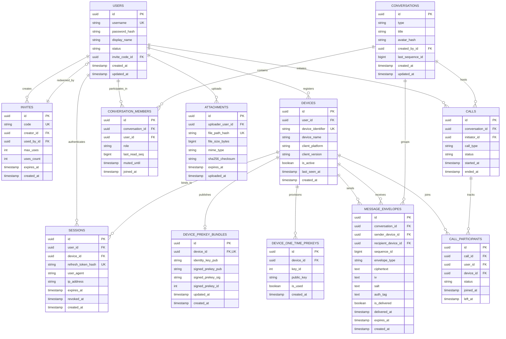
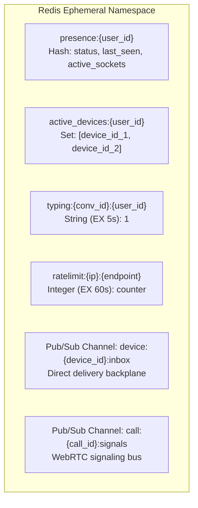
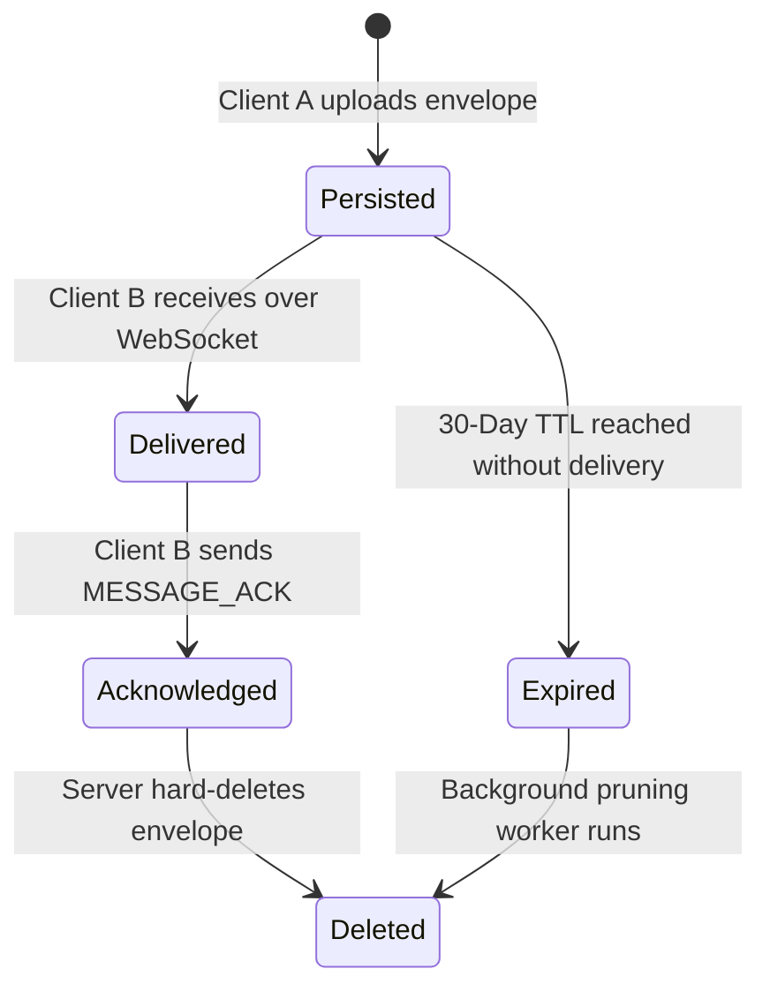

# Project Spectra: Database Specification & Persistence Architecture

> **Document Status**: Approved Baseline (Phase 0)  
> **Authors**: Principal Software Architect & Technical Lead  
> **Target Audience**: Backend Engineers, Database Administrators, Security Auditors

---

## 1. Persistence Philosophy & Data Tier Principles

Project Spectra implements a strict dual-tier persistence model:
1. **Durable Relational Tier (PostgreSQL 16+)**: Stores structured, relational, and durable application entities (identities, device registries, cryptographic pre-key bundles, conversation metadata, and the untrusted store-and-forward encrypted message mailbox).
2. **Ephemeral In-Memory Tier (Redis 7.2+)**: Manages transient state, real-time presence, typing indicators, rate-limiting counters, and the multi-worker pub/sub event backplane.

### Core Persistence Invariants

- **Zero-Knowledge Payloads**: Plaintext message contents, user private keys, attachment decryption keys, and media streams are **never** persisted to any server-side database.
- **Untrusted Mailbox Model**: Message envelopes are persisted in PostgreSQL strictly as opaque ciphertext blobs. Once delivered and acknowledged (`ACK`) by all target recipient devices, envelopes are subject to immediate hard-deletion or periodic pruning.
- **UUIDv7 Primary Keys**: All primary database keys use time-sortable **UUIDv7** (or 64-bit BigInt sequences where strict monotonicity is required), preventing sequential enumeration attacks while maintaining optimal B-Tree index locality.
- **Strict Referential Integrity**: Cascading foreign keys enforce clean state upon device revocation or user deletion, preventing orphaned pre-keys or dangling session tokens.

---

## 2. Entity-Relationship Diagram (ERD)



---

## 3. Relational Database Schemas (PostgreSQL 16+)

### 3.1 Authentication & User Management

#### `users`
Core identity table representing registered user accounts.
```sql
CREATE TABLE users (
    id UUID PRIMARY KEY DEFAULT gen_random_uuid(),
    username VARCHAR(32) NOT NULL,
    password_hash VARCHAR(255) NOT NULL,
    display_name VARCHAR(64) NOT NULL,
    status VARCHAR(16) NOT NULL DEFAULT 'active' CHECK (status IN ('active', 'suspended', 'deactivated')),
    invite_code_id UUID,
    created_at TIMESTAMPTZ NOT NULL DEFAULT CURRENT_TIMESTAMP,
    updated_at TIMESTAMPTZ NOT NULL DEFAULT CURRENT_TIMESTAMP,
    CONSTRAINT uq_users_username UNIQUE (username)
);

CREATE INDEX idx_users_username ON users (username);
CREATE INDEX idx_users_status ON users (status);
```

#### `invites`
Invite-only gating mechanism to prevent unauthorized public registration and spam.
```sql
CREATE TABLE invites (
    id UUID PRIMARY KEY DEFAULT gen_random_uuid(),
    code VARCHAR(32) NOT NULL,
    creator_id UUID NOT NULL REFERENCES users(id) ON DELETE CASCADE,
    used_by_id UUID REFERENCES users(id) ON DELETE SET NULL,
    max_uses INT NOT NULL DEFAULT 1,
    uses_count INT NOT NULL DEFAULT 0,
    expires_at TIMESTAMPTZ NOT NULL,
    created_at TIMESTAMPTZ NOT NULL DEFAULT CURRENT_TIMESTAMP,
    CONSTRAINT uq_invites_code UNIQUE (code),
    CONSTRAINT chk_invites_uses CHECK (uses_count <= max_uses)
);

CREATE INDEX idx_invites_code ON invites (code);
CREATE INDEX idx_invites_expires ON invites (expires_at);
```

---

### 3.2 Devices & Cryptographic Key Directory

#### `devices`
Tracks distinct client hardware/browser instances bound to a user account.
```sql
CREATE TABLE devices (
    id UUID PRIMARY KEY DEFAULT gen_random_uuid(),
    user_id UUID NOT NULL REFERENCES users(id) ON DELETE CASCADE,
    device_identifier VARCHAR(64) NOT NULL,
    device_name VARCHAR(64) NOT NULL,
    client_platform VARCHAR(32) NOT NULL, -- 'web', 'desktop', 'android', 'ios'
    client_version VARCHAR(32) NOT NULL,
    is_active BOOLEAN NOT NULL DEFAULT TRUE,
    last_seen_at TIMESTAMPTZ NOT NULL DEFAULT CURRENT_TIMESTAMP,
    created_at TIMESTAMPTZ NOT NULL DEFAULT CURRENT_TIMESTAMP,
    CONSTRAINT uq_user_device_identifier UNIQUE (user_id, device_identifier)
);

CREATE INDEX idx_devices_user_id ON devices (user_id);
CREATE INDEX idx_devices_active ON devices (is_active);
```

#### `sessions`
Tracks active authenticated sessions and refresh token rotation families.
```sql
CREATE TABLE sessions (
    id UUID PRIMARY KEY DEFAULT gen_random_uuid(),
    user_id UUID NOT NULL REFERENCES users(id) ON DELETE CASCADE,
    device_id UUID NOT NULL REFERENCES devices(id) ON DELETE CASCADE,
    refresh_token_hash VARCHAR(64) NOT NULL,
    user_agent TEXT,
    ip_address INET,
    expires_at TIMESTAMPTZ NOT NULL,
    revoked_at TIMESTAMPTZ,
    created_at TIMESTAMPTZ NOT NULL DEFAULT CURRENT_TIMESTAMP,
    CONSTRAINT uq_sessions_refresh_token_hash UNIQUE (refresh_token_hash)
);

CREATE INDEX idx_sessions_user_device ON sessions (user_id, device_id);
CREATE INDEX idx_sessions_expires ON sessions (expires_at) WHERE revoked_at IS NULL;
```

#### `device_prekey_bundles`
Holds public cryptographic identity and signed pre-key bundles for asynchronous X3DH/Olm session establishment.
```sql
CREATE TABLE device_prekey_bundles (
    id UUID PRIMARY KEY DEFAULT gen_random_uuid(),
    device_id UUID NOT NULL REFERENCES devices(id) ON DELETE CASCADE,
    identity_key_pub VARCHAR(64) NOT NULL,     -- Base64 Curve25519 / Ed25519 public key
    signed_prekey_pub VARCHAR(64) NOT NULL,   -- Base64 Curve25519 public key
    signed_prekey_sig VARCHAR(128) NOT NULL,  -- Base64 Ed25519 signature
    signed_prekey_id INT NOT NULL,
    updated_at TIMESTAMPTZ NOT NULL DEFAULT CURRENT_TIMESTAMP,
    created_at TIMESTAMPTZ NOT NULL DEFAULT CURRENT_TIMESTAMP,
    CONSTRAINT uq_device_prekey_bundle UNIQUE (device_id)
);

CREATE INDEX idx_prekeys_device ON device_prekey_bundles (device_id);
```

#### `device_one_time_prekeys`
Holds single-use pre-keys for X3DH session initiation. Once claimed, keys are flagged and consumed.
```sql
CREATE TABLE device_one_time_prekeys (
    id UUID PRIMARY KEY DEFAULT gen_random_uuid(),
    device_id UUID NOT NULL REFERENCES devices(id) ON DELETE CASCADE,
    key_id INT NOT NULL,
    public_key VARCHAR(64) NOT NULL,          -- Base64 Curve25519 public key
    is_used BOOLEAN NOT NULL DEFAULT FALSE,
    created_at TIMESTAMPTZ NOT NULL DEFAULT CURRENT_TIMESTAMP,
    CONSTRAINT uq_device_otk_id UNIQUE (device_id, key_id)
);

CREATE INDEX idx_device_otk_available ON device_one_time_prekeys (device_id) WHERE is_used = FALSE;
```

---

### 3.3 Messaging, Groups, & Untrusted Mailbox

#### `conversations`
Direct (1:1) and Group conversation containers.
```sql
CREATE TABLE conversations (
    id UUID PRIMARY KEY DEFAULT gen_random_uuid(),
    type VARCHAR(16) NOT NULL CHECK (type IN ('direct', 'group')),
    title VARCHAR(128),                       -- Nullable for direct chats
    avatar_hash VARCHAR(64),
    created_by_id UUID REFERENCES users(id) ON DELETE SET NULL,
    last_sequence_id BIGINT NOT NULL DEFAULT 0,
    created_at TIMESTAMPTZ NOT NULL DEFAULT CURRENT_TIMESTAMP,
    updated_at TIMESTAMPTZ NOT NULL DEFAULT CURRENT_TIMESTAMP
);

CREATE INDEX idx_conversations_type ON conversations (type);
```

#### `conversation_members`
Maintains group memberships, access roles, and synchronization pointers.
```sql
CREATE TABLE conversation_members (
    id UUID PRIMARY KEY DEFAULT gen_random_uuid(),
    conversation_id UUID NOT NULL REFERENCES conversations(id) ON DELETE CASCADE,
    user_id UUID NOT NULL REFERENCES users(id) ON DELETE CASCADE,
    role VARCHAR(16) NOT NULL DEFAULT 'member' CHECK (role IN ('owner', 'admin', 'member')),
    last_read_seq BIGINT NOT NULL DEFAULT 0,
    muted_until TIMESTAMPTZ,
    joined_at TIMESTAMPTZ NOT NULL DEFAULT CURRENT_TIMESTAMP,
    CONSTRAINT uq_conversation_user UNIQUE (conversation_id, user_id)
);

CREATE INDEX idx_conv_members_user ON conversation_members (user_id);
CREATE INDEX idx_conv_members_conv ON conversation_members (conversation_id);
```

#### `message_envelopes`
The core untrusted store-and-forward mailbox. Contains **only opaque ciphertexts**.
```sql
CREATE TABLE message_envelopes (
    id UUID PRIMARY KEY DEFAULT gen_random_uuid(),
    conversation_id UUID NOT NULL REFERENCES conversations(id) ON DELETE CASCADE,
    sender_device_id UUID NOT NULL REFERENCES devices(id) ON DELETE CASCADE,
    recipient_device_id UUID NOT NULL REFERENCES devices(id) ON DELETE CASCADE,
    sequence_id BIGINT NOT NULL,              -- Monotonic per recipient device
    envelope_type VARCHAR(24) NOT NULL,       -- 'olm_prekey', 'olm_msg', 'megolm_msg', 'megolm_key_share', 'control'
    ciphertext TEXT NOT NULL,                 -- Base64 encoded encrypted payload
    iv TEXT,                                  -- Base64 initialization vector / nonce (if separated)
    salt TEXT,                                -- Optional KDF salt
    auth_tag TEXT,                            -- Authentication tag (AES-GCM / Poly1305)
    is_delivered BOOLEAN NOT NULL DEFAULT FALSE,
    delivered_at TIMESTAMPTZ,
    expires_at TIMESTAMPTZ NOT NULL,          -- Default: created_at + INTERVAL '30 days'
    created_at TIMESTAMPTZ NOT NULL DEFAULT CURRENT_TIMESTAMP
);

-- Crucial composite index for high-speed offline catch-up queries
CREATE INDEX idx_envelopes_sync ON message_envelopes (recipient_device_id, sequence_id ASC)
    WHERE is_delivered = FALSE;

-- Cleanup index for TTL background worker
CREATE INDEX idx_envelopes_expiry ON message_envelopes (expires_at)
    WHERE is_delivered = TRUE;
```

#### `attachments`
Holds metadata for client-side encrypted media files stored on the filesystem / object store.
```sql
CREATE TABLE attachments (
    id UUID PRIMARY KEY DEFAULT gen_random_uuid(),
    uploader_user_id UUID NOT NULL REFERENCES users(id) ON DELETE CASCADE,
    file_path_hash VARCHAR(64) NOT NULL,      -- SHA-256 hash representing storage path
    file_size_bytes BIGINT NOT NULL,
    mime_type VARCHAR(128) NOT NULL,          -- e.g. 'application/octet-stream' (opaque)
    sha256_checksum VARCHAR(64) NOT NULL,     -- Verification hash of the ciphertext blob
    expires_at TIMESTAMPTZ,                   -- Optional ephemeral media expiry
    uploaded_at TIMESTAMPTZ NOT NULL DEFAULT CURRENT_TIMESTAMP,
    CONSTRAINT uq_attachment_path UNIQUE (file_path_hash)
);

CREATE INDEX idx_attachments_uploader ON attachments (uploader_user_id);
```

---

### 3.4 WebRTC Calling & Call Tracking

#### `calls`
Maintains call session records for history and signaling orchestration.
```sql
CREATE TABLE calls (
    id UUID PRIMARY KEY DEFAULT gen_random_uuid(),
    conversation_id UUID NOT NULL REFERENCES conversations(id) ON DELETE CASCADE,
    initiator_id UUID NOT NULL REFERENCES users(id) ON DELETE CASCADE,
    call_type VARCHAR(16) NOT NULL CHECK (call_type IN ('audio', 'video')),
    status VARCHAR(16) NOT NULL DEFAULT 'ringing' 
        CHECK (status IN ('ringing', 'ongoing', 'ended', 'rejected', 'missed', 'busy')),
    started_at TIMESTAMPTZ NOT NULL DEFAULT CURRENT_TIMESTAMP,
    ended_at TIMESTAMPTZ
);

CREATE INDEX idx_calls_conv ON calls (conversation_id);
CREATE INDEX idx_calls_initiator ON calls (initiator_id);
```

#### `call_participants`
Tracks participant connection status in calls.
```sql
CREATE TABLE call_participants (
    id UUID PRIMARY KEY DEFAULT gen_random_uuid(),
    call_id UUID NOT NULL REFERENCES calls(id) ON DELETE CASCADE,
    user_id UUID NOT NULL REFERENCES users(id) ON DELETE CASCADE,
    device_id UUID REFERENCES devices(id) ON DELETE SET NULL,
    status VARCHAR(16) NOT NULL DEFAULT 'invited' 
        CHECK (status IN ('invited', 'accepted', 'declined', 'left', 'timeout')),
    joined_at TIMESTAMPTZ,
    left_at TIMESTAMPTZ,
    CONSTRAINT uq_call_participant UNIQUE (call_id, user_id, device_id)
);

CREATE INDEX idx_call_participants_call ON call_participants (call_id);
```

---

## 4. Redis Ephemeral Data Structures & Caching

Redis 7.2+ is used exclusively for ephemeral, low-latency, and pub/sub operations. No critical cryptographic state or unread message history resides exclusively in Redis.



### 4.1 Redis Key Specification

| Key / Pattern | Type | TTL | Description |
| :--- | :--- | :--- | :--- |
| `presence:{user_id}` | `HASH` | 60 sec (refreshed on ping) | Holds `status` ('online' / 'offline'), `last_seen` timestamp, and count of active connections. |
| `active_devices:{user_id}` | `SET` | None (managed on connect/disconnect) | List of currently connected `device_id`s for rapid multi-device routing. |
| `typing:{conv_id}:{user_id}` | `STRING` | 5 sec | Set when a user starts typing. Auto-expires if not refreshed, preventing stuck indicators. |
| `ratelimit:{ip}:{endpoint}` | `STRING` | 60 sec | Fixed/sliding window rate limit counter. |
| `turn:secret` | `STRING` | 86400 sec | Cached HMAC shared secret for Coturn REST authentication. |

### 4.2 Redis Pub/Sub Topology

- **Device Inbox Channels**: `device:{device_id}:inbox`  
  *Usage*: When an ASGI worker accepts an incoming envelope for `target_device_id`, it publishes the envelope payload to this channel. The specific worker maintaining the WebSocket connection for that device reads the message and immediately transmits the JSON frame to the client.
- **Call Signaling Channels**: `call:{call_id}:signals`  
  *Usage*: Ephemeral WebRTC SDP offers/answers and ICE candidates are published here for rapid routing between call participant sockets without touching PostgreSQL.

---

## 5. Data Retention, Pruning, & Lifecycle Management

### 5.1 The Untrusted Mailbox Lifecycle



1. **Immediate ACK Purge**: When an envelope is addressed to a single recipient device, once the client returns `MESSAGE_ACK`, the server executes:
   ```sql
   DELETE FROM message_envelopes WHERE id = :envelope_id;
   ```
2. **Multi-Device / Group Envelopes**: In group scenarios or multi-device fan-out, envelopes are addressed to specific `recipient_device_id`s individually. Once an individual envelope is ACKed by its target device, it is deleted.
3. **Automated Pruning Cron Job**: An asynchronous background Celery/APScheduler task runs every hour to remove uncollected envelopes exceeding the 30-day retention threshold:
   ```sql
   DELETE FROM message_envelopes WHERE expires_at < CURRENT_TIMESTAMP;
   ```

### 5.2 One-Time Prekey Replenishment

- When a peer fetches a pre-key bundle for a target device, one unused key from `device_one_time_prekeys` is marked `is_used = TRUE`.
- When the count of remaining unused keys drops below a threshold ($\le 20$), the server includes a warning header `X-Replenish-Prekeys: true` in WebSocket heartbeats or REST responses.
- The client device generates 50 new One-Time Pre-Keys and uploads them via `/api/v1/crypto/prekeys/upload`.

---

## 6. Indexing & Partitioning Strategy

### 6.1 Index Strategy for Monotonic Queues
The most performance-critical query on the server is offline catch-up sync:
```sql
SELECT id, conversation_id, sequence_id, envelope_type, ciphertext, iv, auth_tag, created_at
FROM message_envelopes
WHERE recipient_device_id = :device_id AND sequence_id > :last_synced_seq
ORDER BY sequence_id ASC
LIMIT 100;
```
This is fully satisfied by the partial composite index:
```sql
CREATE INDEX idx_envelopes_sync ON message_envelopes (recipient_device_id, sequence_id ASC)
    WHERE is_delivered = FALSE;
```
This ensures zero table-scan overhead, performing an index range scan directly on uncollected envelopes.

### 6.2 Table Partitioning (Future Scale)
For deployments processing millions of envelopes per day, `message_envelopes` will be partitioned using **PostgreSQL Declarative Table Partitioning by Range (`created_at`)**:
```sql
CREATE TABLE message_envelopes (
    id UUID NOT NULL,
    conversation_id UUID NOT NULL,
    recipient_device_id UUID NOT NULL,
    sequence_id BIGINT NOT NULL,
    ciphertext TEXT NOT NULL,
    created_at TIMESTAMPTZ NOT NULL,
    ...
) PARTITION BY RANGE (created_at);
```
Weekly partitions permit instant dropping of expired envelopes (`DROP TABLE message_envelopes_y2026_w46`) with zero VACUUM overhead.
