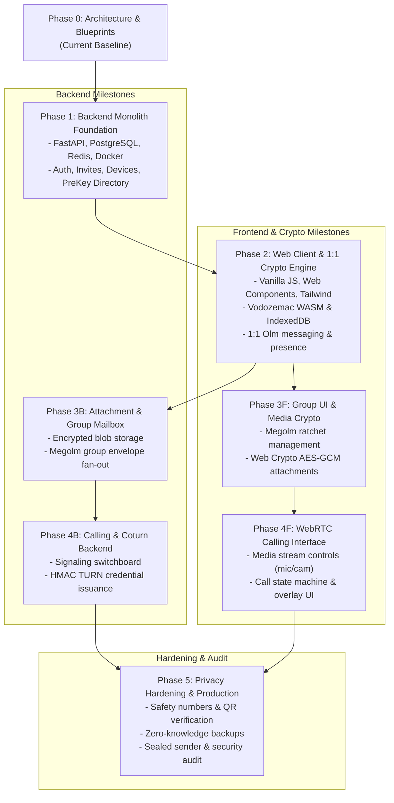

# Project Spectra: Engineering Roadmap & Milestones

> **Document Status**: Approved Baseline (Phase 0)  
> **Authors**: Principal Software Architect & Technical Lead  
> **Target Audience**: Engineering Leadership, Product Managers, Developers

---

## 1. Development Philosophy & Phased Strategy

Project Spectra follows a disciplined, phased execution strategy designed to eliminate architectural ambiguity before code is committed. Each phase delivers a strictly verified, testable increment of the system.

### Core Phasing Tenets

1. **Architecture Before Implementation**: Security protocols and database schemas must be peer-reviewed and mathematically validated before writing application features.
2. **Cryptographic Isolation**: Cryptographic routines are isolated and tested independently using known test vectors before being coupled with networking layers.
3. **Continuous Integration of Infrastructure**: Persistence tiers (PostgreSQL, Redis) and relay infrastructure (Coturn) run in containerized environments from day one.
4. **Zero Technical Debt on Critical Path**: Security boundaries, automated tests, and migration scripts are non-negotiable prerequisites for each milestone's Definition of Done.

---

## 2. Milestone Dependency Graph

---

## 3. Detailed Phase Breakdown

### Phase 0: Architecture, Cryptography & Planning (CURRENT)
- **Objective**: Establish complete technical specifications, data schemas, API contracts, threat models, and architectural decision records.
- **Key Deliverables**:
  - `README.md` — Project mission, technical stack, and development guidelines.
  - `docs/ARCHITECTURE.md` — System architecture, modular monolith layout, and critical questions.
  - `docs/DATABASE.md` — Complete PostgreSQL schemas, indexing strategy, and Redis structures.
  - `docs/API.md` — REST and WebSocket framing specifications.
  - `docs/SECURITY.md` — Threat model, cryptographic primitives, and metadata analysis.
  - `docs/ROADMAP.md` — Phased milestones and dependency tracking.
  - `docs/DECISIONS.md` — Formal Architectural Decision Records (ADRs).
  - `docs/TESTING.md` — Multi-tiered testing strategy.
- **Definition of Done (DoD)**: All documentation deliverables complete, cross-referenced, and reviewed without unresolved architectural blockers.

---

### Phase 1: Core Monolith Foundation & Device PreKey Directory
- **Objective**: Stand up the asynchronous backend modular monolith, database migrations, authentication engine, and cryptographic pre-key directory.
- **Key Deliverables**:
  - `docker-compose.yml` with PostgreSQL 16, Redis 7.2, and FastAPI container.
  - Database schema migrations via Alembic.
  - `auth` module: Invite-code validation, Argon2id hashing, JWT issuance, and refresh token rotation.
  - `devices` module: Device registration, session binding, and active tracking.
  - `encryption` module: PreKey bundle upload and single-use One-Time Prekey atomic claim endpoints.
  - Asynchronous unit and integration test suite with Pytest and Testcontainers.
- **Definition of Done (DoD)**:
  - 100% test coverage on authentication flows and pre-key bundle atomic reservations.
  - Static analysis passing (Ruff linting, MyPy strict type checks).

---

### Phase 2: Web Client Core & 1:1 Cryptographic Engine
- **Objective**: Build the framework-free Vanilla JS web client, initialize the `@matrix-org/vodozemac` WASM cryptographic engine, and enable 1:1 end-to-end encrypted messaging.
- **Key Deliverables**:
  - Web client shell: Vanilla JS (ES6+), Web Components, and Tailwind CSS dark-first theme.
  - Client-side cryptographic subsystem:
    - Identity Key and Signed Pre-Key generation using `vodozemac`.
    - Local persistence using IndexedDB (encrypted session states).
    - Asynchronous X3DH / Olm session initiation.
  - Real-time communication layer:
    - Reconnecting WebSocket client (`/ws/v1/connect`).
    - Store-and-forward untrusted mailbox queue in PostgreSQL.
    - Double Ratchet message encryption/decryption loop.
  - Real-time presence and typing indicator dispatch via Redis.
- **Definition of Done (DoD)**:
  - Two distinct web browser clients can register, exchange prekeys, establish an Olm session, and exchange real-time encrypted messages.
  - Verified zero plaintext stored in PostgreSQL or Redis.
  - Messages sent while a client is offline are cleanly delivered and decrypted upon reconnect.

---

### Phase 3: Group Messaging & Encrypted Attachments
- **Objective**: Implement scalable encrypted group chats via Megolm Sender Keys and client-side encrypted media streaming.
- **Key Deliverables**:
  - `groups` backend module: Group creation, membership management, and role-based permissions.
  - Megolm Group Session management on the client:
    - Outbound Megolm session generation and ratchet advancement.
    - Pairwise session key sharing over existing 1:1 Olm channels.
    - Automatic session invalidation and re-keying on member departure.
  - Encrypted Attachment Pipeline:
    - Client-side chunked encryption using AES-256-GCM via Web Crypto API.
    - SHA-256 integrity verification.
    - Backend upload and streaming download endpoints.
  - Virtualized chat message timeline supporting media previews.
- **Definition of Done (DoD)**:
  - Groups of up to 500 participants can exchange messages with $O(1)$ client upload overhead.
  - Member removal proves mathematically that the evicted participant cannot decrypt subsequent messages.
  - Encrypted images and files upload, download, and render smoothly in the browser.

---

### Phase 4: WebRTC Real-Time Voice & Video Calling
- **Objective**: Integrate Coturn STUN/TURN infrastructure, implement WebSocket call signaling, and deliver 1:1 voice and video calling.
- **Key Deliverables**:
  - Coturn deployment in Docker with HMAC-SHA1 REST API authentication.
  - Backend `calling` module: Call session state tracking, ephemeral ICE credential generation, and signaling relay.
  - Frontend `webrtc_manager.js`:
    - `RTCPeerConnection` lifecycle management.
    - Local media capture (`getUserMedia`) with mic mute, camera toggle, and speaker selection.
    - Incoming call overlay, ringtones, accept/reject workflows.
    - Fallback ICE candidate handling (STUN direct vs TURN relay).
- **Definition of Done (DoD)**:
  - Voice and video calls successfully connect between two clients across restrictive symmetric NATs via Coturn.
  - Media stream is verified to be DTLS-SRTP encrypted.
  - Call disconnects and timeouts gracefully clean up state across all participants.

---

### Phase 5: Privacy Hardening, Usability & Production Readiness
- **Objective**: Implement advanced privacy controls, safety number verification, zero-knowledge backups, and prepare for production deployment.
- **Key Deliverables**:
  - Safety Number generation (fingerprint comparison & interactive QR code scanning).
  - TOFU (Trust On First Use) security alert banner upon key changes.
  - Zero-knowledge passphrase-derived backup export/import (Argon2id + BIP-39 mnemonic).
  - Sealed Sender experimental implementation (anonymized envelope routing).
  - Comprehensive security audit preparation and automated fuzz testing.
  - Production deployment bundle: Multi-stage Dockerfiles, Caddy/Nginx reverse proxy configs, monitoring probes.
- **Definition of Done (DoD)**:
  - Zero security alerts on static analysis (Bandit, Trivy, Semgrep).
  - Full end-to-end user journey verified under high latency and packet loss conditions.

---

## 4. Risk Register & Mitigation Strategy

| Risk ID | Identified Risk | Impact | Likelihood | Mitigation Strategy |
| :--- | :--- | :--- | :--- | :--- |
| **R-01** | Browser IndexedDB eviction under storage pressure loses ratchet states. | High | Medium | Request persistent storage (`navigator.storage.persist()`); implement zero-knowledge encrypted cloud state backups. |
| **R-02** | WebAssembly initialization lag degrades initial page load performance. | Medium | Low | Asynchronously preload and initialize WASM modules during the splash/login screen; cache compiled WASM in IndexedDB. |
| **R-03** | TURN server bandwidth saturation during high video call volume. | High | Medium | Enforce strict HMAC token expiration (1 hour); prioritize direct STUN P2P connections; rate-limit simultaneous call allocations. |
| **R-04** | Group desynchronization when pairwise session key sharing fails for offline members. | High | Medium | Store unacknowledged session keys in local outbox queues and re-transmit automatically during periodic sync handshakes. |
| **R-05** | Pre-Key exhaustion attack (adversary repeatedly requests prekeys to deplete OTKs). | Medium | Medium | Rate-limit pre-key bundle requests per client IP/user; alert client to replenish when pool falls below 20 keys. |
