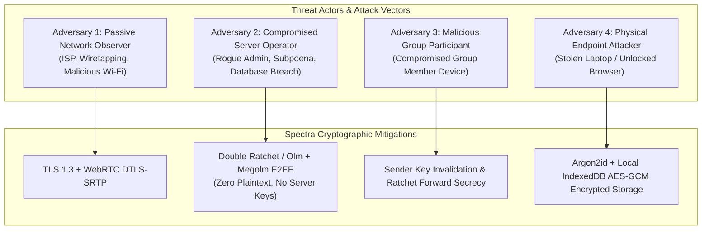
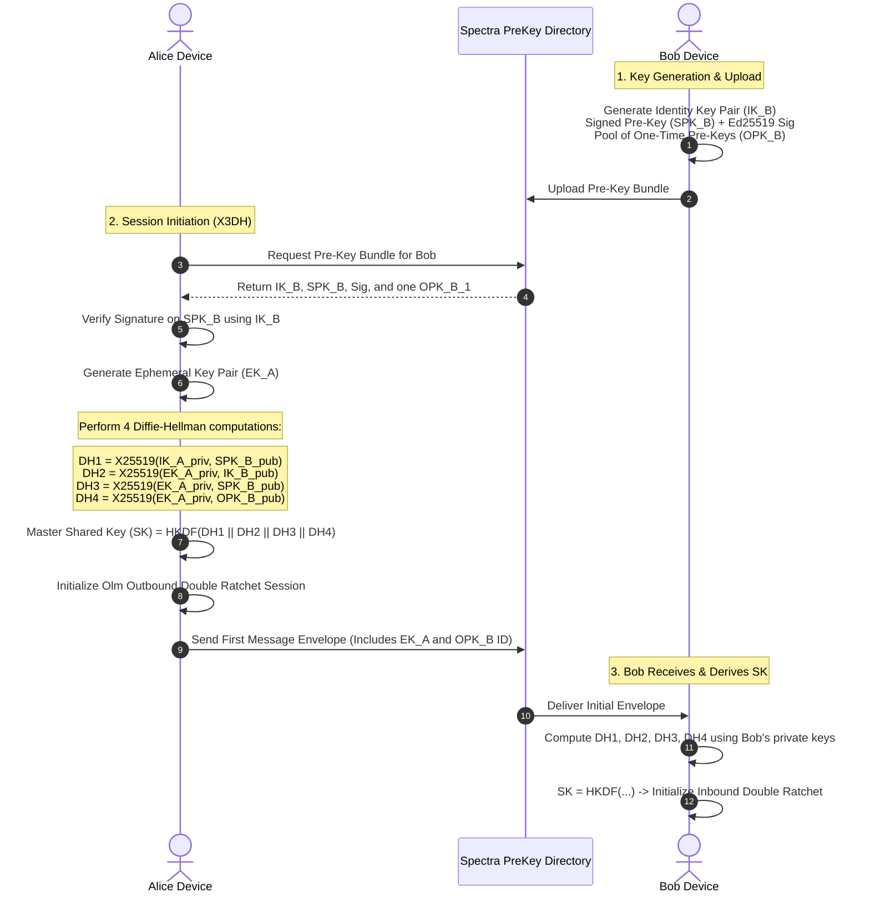
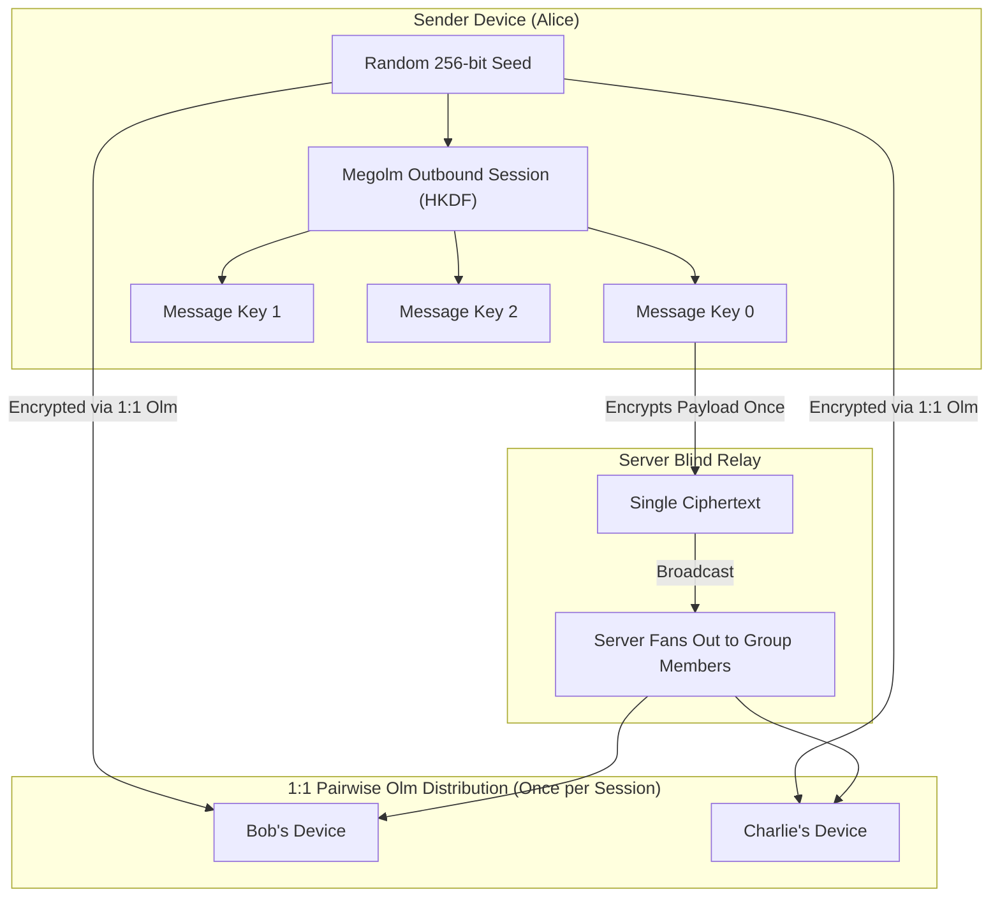
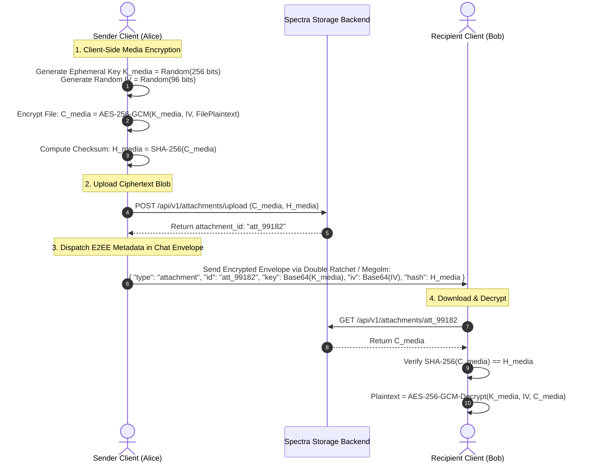

# Project Spectra: Threat Model, Cryptographic Architecture, & Security Specification

> **Document Status**: Approved Baseline (Phase 0)  
> **Authors**: Principal Software Architect & Technical Lead  
> **Target Audience**: Cryptographers, Security Auditors, Backend & Frontend Engineers

---

## 1. Threat Model & Security Guarantees

Spectra is engineered with the foundational premise that **the network is hostile and the server infrastructure is inherently untrusted**.

### 1.1 Adversary Models

1. **Adversary 1: Passive / Active Network Observer (Man-in-the-Middle)**:
   - *Capabilities*: Can intercept, inject, drop, or inspect IP packets between clients, reverse proxies, and TURN servers.
   - *Mitigation*: Mandatory TLS 1.3 with strict HSTS for all REST and WebSocket connections. Mandatory DTLS 1.2/1.3 and SRTP for all WebRTC media flows.
2. **Adversary 2: Compromised Server Operator / Malicious Relay**:
   - *Capabilities*: Possesses root access to PostgreSQL, Redis, ASGI server memory, and filesystem storage. Can modify stored envelopes or attempt eavesdropping.
   - *Mitigation*: The server possesses **zero plaintext access**. Message payloads, attachments, and call streams are encrypted client-side using keys known exclusively to participating device endpoints. Tampering with envelopes causes authentication tag verification failure (AEAD) on the client, resulting in message rejection.
3. **Adversary 3: Malicious or Compromised Group Participant**:
   - *Capabilities*: An authorized group member whose device is compromised, or a removed member attempting to eavesdrop on future conversations.
   - *Mitigation*: Backward and forward secrecy via Sender Key ratchets. When a member is removed, all remaining members immediately generate new Sender Keys and distribute them exclusively to the remaining group members via pairwise ratchets.
4. **Adversary 4: Physical Endpoint / Stolen Device Attacker**:
   - *Capabilities*: Has physical access to an unlocked or seized browser device.
   - *Mitigation*: Client-side IndexedDB databases containing cryptographic sessions and plaintext history are encrypted using AES-256-GCM derived from a user master passphrase or device PIN via Argon2id.

### 1.2 Security Guarantees & Explicit Non-Guarantees

| Property | Guarantee Status | Cryptographic Mechanism |
| :--- | :--- | :--- |
| **Payload Confidentiality** | **Guaranteed** | E2EE via Double Ratchet / Megolm with Curve25519 and AES-256-GCM. |
| **Message Integrity & Authenticity** | **Guaranteed** | AEAD authentication tags (Poly1305 / AES-GCM) verified on client. |
| **Forward Secrecy (FS)** | **Guaranteed** | Ratchet advance per message. Compromising current key cannot decrypt past messages. |
| **Post-Compromise Security (PCS)** | **Guaranteed (1:1)** | Diffie-Hellman ratchet steps heal the session upon the next uncompromised exchange. |
| **Media Confidentiality** | **Guaranteed** | DTLS-SRTP for WebRTC; AES-256-GCM for media file attachments. |
| **Endpoint Hardware Compromise** | **Non-Guarantee** | If an attacker installs a keylogger or kernel rootkit on a client device, plaintext can be intercepted at the UI layer. |
| **Metadata Anonymity (Phase 1-3)**| **Partial** | Server learns routing metadata (who speaks to whom, timing, ciphertext size). Sealed Sender is planned for Phase 5. |

---

## 2. Cryptographic Protocol Evaluation & Primitives

Spectra evaluated three potential protocol ecosystems for client-side web E2EE:

### 2.1 Protocol Selection Matrix

| Criterion | `@signalapp/libsignal-client` | `@matrix-org/vodozemac` | MLS (RFC 9420 / OpenMLS) |
| :--- | :--- | :--- | :--- |
| **Core Protocol** | Signal Protocol (Double Ratchet, X3DH) | Olm (Double Ratchet, X3DH) & Megolm | Messaging Layer Security (TreeKEM) |
| **Implementation** | Rust compiled to WASM | Pure Rust compiled to WASM | Rust (WASM bindings experimental) |
| **Software License** | **AGPL-3.0** (Strong Copyleft) | **Apache-2.0** (Permissive) | Apache-2.0 / MIT |
| **Group Scalability** | Sender Keys ($O(1)$ send) | Megolm Ratchet ($O(1)$ send) | TreeKEM ($O(\log N)$ send & rekey) |
| **Web / Browser Maturity** | Tied to Electron/Desktop | First-class browser WASM support | Early-stage browser WASM tooling |
| **Audit Status** | Extensively audited | Audited by Least Authority (2022) | Audited specifications, evolving SDKs |
| **Decision** | **Rejected** (License incompatibility) | **Selected** (Production Standard) | **Deferred** (Evaluate for Future Group Scale) |

**Conclusion**: Project Spectra standardizes on **`@matrix-org/vodozemac`** for client-side cryptographic ratcheting. It implements the exact mathematical principles of the Double Ratchet and Megolm algorithms, is memory-safe (Rust), permissive (Apache 2.0), and battle-tested across millions of Web clients in the Matrix ecosystem.

---

## 3. Asynchronous Session Establishment & The Double Ratchet

### 3.1 Initial Key Agreement: Extended Triple Diffie-Hellman (X3DH / Olm)

When Alice ($A$) initiates an encrypted session with Bob's device ($B$) asynchronously:

### 3.2 Double Ratchet Inner Mechanics

Once established, each 1:1 conversation advances via two interwoven ratchets:
1. **Symmetric-Key KDF Ratchet**: For every message sent or received, a KDF chain advances:
   $$\text{MessageKey}_i, \text{ChainKey}_{i+1} = \text{KDF}(\text{ChainKey}_i)$$
   This provides instantaneous **Forward Secrecy**: if $\text{ChainKey}_{i+1}$ is compromised, mathematical one-way functions prevent an attacker from deriving $\text{MessageKey}_i$ or past keys.
2. **Diffie-Hellman (DH) Ratchet**: Every time a communication turn changes (Alice receives a reply from Bob), a new ephemeral Curve25519 key exchange occurs, yielding a fresh root key. This provides **Post-Compromise Security (Break-in Recovery)**: if an attacker compromises a client's state at time $t$, they lose the ability to decrypt messages as soon as an uncompromised DH exchange completes.

---

## 4. Encrypted Group Messaging Architecture (Megolm Model)

For groups of 3 to 1,000+ members, Spectra implements the **Megolm Symmetric Group Ratchet**:

### 4.1 Group Session Lifecycle & Member Revocation

1. **Session Setup**:
   - Alice creates a Megolm Outbound Session.
   - Alice encrypts the session key, session ID, and initial ratchet index ($i=0$) using her 1:1 Olm sessions with Bob and Charlie.
   - Bob and Charlie store this as an Inbound Group Session for Alice.
2. **Message Transmission**:
   - Alice encrypts her message once using the current Megolm message key via AES-256-GCM.
   - The server fans out the *single* ciphertext to all group members ($O(1)$ client transmission).
3. **Handling Member Departure (Forward Secrecy Enforcement)**:
   - When Charlie leaves or is removed from the group:
   - **Immediate Invalidation**: All remaining members (Alice, Bob) discard their active Megolm Outbound Sessions.
   - **Re-Keying**: Alice and Bob generate brand new Outbound Sessions and distribute their keys **only** to authorized members (Alice $\to$ Bob, Bob $\to$ Alice).
   - Charlie never receives the new session keys and is cryptographically barred from decrypting subsequent messages, even if he intercepts the server traffic.

---

## 5. Client-Side Attachment Encryption Pipeline

Attachments (images, audio notes, video, documents) never touch the server in plaintext.

The server stores strictly opaque, encrypted binary blobs. It has no access to `K_media` or `IV`.

---

## 6. Authentication, Session Security, & Token Rotation

### 6.1 Password Hashing Specification
User passwords are exclusively hashed using **Argon2id** conforming to RFC 9106 recommended parameters:
- **Variant**: Argon2id (hybrid data-dependent / data-independent memory access)
- **Memory Cost ($m$)**: $65,536\text{ KiB}$ (64 MB)
- **Time Cost ($t$)**: 3 iterations
- **Parallelism ($p$)**: 4 threads
- **Salt Length**: 16 cryptographically random bytes (`os.urandom`)
- **Key Length**: 32 bytes

### 6.2 JWT Issuance & Refresh Token Family Rotation

- **Access Tokens**: Short-lived (15 minutes), signed using Ed25519 (Asymmetric EdDSA) or HMAC-SHA256. Contains `user_id`, `device_id`, `session_id`, and expiry timestamp.
- **Refresh Tokens**: Long-lived (30 days), stored as a cryptographic SHA-256 hash in PostgreSQL.
- **Reuse Detection**: Each refresh token belongs to a cryptographic token family. When a refresh token is exchanged, a new refresh token is issued and the previous one is invalidated. If an already-consumed refresh token is presented (indicating a replay or token interception attack), **the entire session family is instantly revoked**, terminating all active sessions for that device.

---

## 7. Device Verification, Safety Numbers, & Revocation

### 7.1 Safety Numbers & Out-of-Band Verification

To protect against active MITM attacks (where a compromised server might substitute public keys in the pre-key directory), Spectra implements **Safety Numbers**:
- The safety number is a deterministic fingerprint derived from the sorted concatenation of Alice's and Bob's Curve25519/Ed25519 Identity Public Keys:
  $$\text{Fingerprint} = \text{SHA-512}\big( \min(IK_A, IK_B) \,\|\, \max(IK_A, IK_B) \big)$$
- Formatted as 12 groups of 5-digit numbers (or an interactive QR code).
- Users verify fingerprints out-of-band (or compare Short Authentication Strings during a WebRTC call).
- **TOFU (Trust On First Use) Alerting**: If a contact registers a new device or reinstalls, the client UI prominently displays a warning:  
  *⚠️ "Alice's identity key has changed. This could indicate a device reinstall or a security interception attempt."*

### 7.2 Zero-Knowledge Passphrase-Derived Backups

If a user wishes to backup their historical conversations without surrendering encryption keys to the server:
1. The client generates a 24-word BIP-39 mnemonic seed.
2. A 256-bit encryption key $K_{\text{backup}}$ is derived using Argon2id:
   $$K_{\text{backup}} = \text{Argon2id}(\text{Mnemonic}, \text{Salt}_{\text{user}}, m=64\text{MB}, t=3, p=4)$$
3. The local IndexedDB database is serialized and encrypted using AES-256-GCM with $K_{\text{backup}}$.
4. The resulting encrypted snapshot may be stored on the server as an opaque backup or exported as a local file. The server cannot decrypt the backup without the client-held 24-word mnemonic.

---

## 8. Metadata Minimization & Traffic Analysis Defenses

### 8.1 Metadata Visibility Matrix

| Data Element | Plaintext Visible to Server | Mitigation / Privacy Protection |
| :--- | :--- | :--- |
| Message Text & Emojis | **NO** | End-to-end encrypted |
| Image / File Contents | **NO** | Client-side AES-256-GCM |
| Voice / Video Audio & Video | **NO** | End-to-end DTLS-SRTP |
| Sender Device ID | YES (in Phase 1-3) | Sealed Sender planned for Phase 5 |
| Recipient Device ID | YES | Necessary for mailbox routing |
| Transmission Timestamp | YES | Necessary for sequence ordering; pruned upon delivery |
| Ciphertext Length | YES (approximate) | **Defeated via Padding** (see 8.2) |
| Client IP Address | At socket layer | Redacted from application logs; Tor/VPN friendly |

### 8.2 Cryptographic Message Padding
To prevent an adversary from deducing message contents or file types based on ciphertext length:
- All plaintext payloads are padded to fixed boundary increments (e.g., nearest 128 or 256 bytes) using standard PKCS#7 or random padding before encryption.
- Encrypted envelope lengths therefore reveal minimal correlation with the underlying message length.

---

## 9. Implementation Security Checklist

- [ ] **Content Security Policy (CSP)**: `default-src 'self'; script-src 'self' 'wasm-unsafe-eval'; connect-src 'self' wss: https:; media-src 'self' blob:; object-src 'none'; frame-ancestors 'none';`
- [ ] **Subresource Integrity (SRI)**: Required for all external static dependencies.
- [ ] **WASM Memory Hygiene**: Zero out sensitive key buffers in WebAssembly linear memory immediately after cryptographic key derivation.
- [ ] **Rate Limiting**: Sliding-window rate limiting on all `/api/v1/crypto/prekeys/*` endpoints to thwart bulk key harvesting.
- [ ] **Log Redaction**: Zero logging of tokens, authorization headers, message IDs, or user IP addresses.
