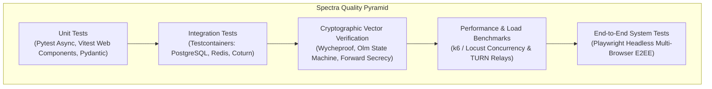
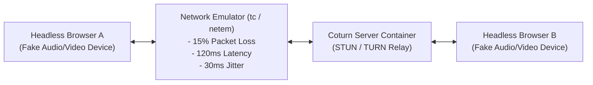
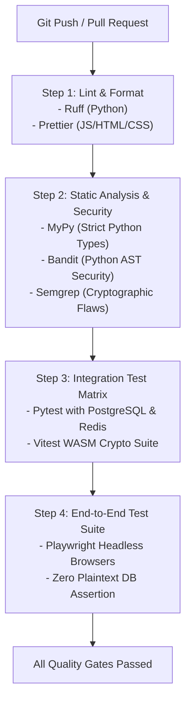

# Project Spectra: Comprehensive Testing Strategy & Quality Assurance Plan

> **Document Status**: Approved Baseline (Phase 0)  
> **Authors**: Principal Software Architect & Technical Lead  
> **Target Audience**: QA Engineers, Core Developers, Security Auditors

---

## 1. Testing Philosophy & Testing Pyramid

Project Spectra adheres to a rigorous, multi-tiered testing hierarchy. Because Spectra handles sensitive communication, correctness, cryptographic integrity, and data confidentiality take strict precedence over raw delivery speed.



### Core Testing Mandates

1. **Zero Plaintext Invariant (ZPI)**: Automated integration tests must inspect database dumps and Redis key dumps to verify mathematically that no plaintext messages or cryptographic private keys are ever stored on the server.
2. **Deterministic Cryptographic Test Vectors**: All cryptographic primitives and ratchet state machines must pass official NIST / Project Wycheproof and Matrix Olm test vectors.
3. **Real Infrastructure in Tests**: Unit and integration tests must run against real PostgreSQL and Redis instances (via `testcontainers-python`), avoiding mock databases that mask transactional anomalies.
4. **Network Chaos & Asynchrony**: Tests must systematically simulate dropped WebSocket packets, out-of-order message delivery, and re-connection handshakes.

---

## 2. Backend Testing Architecture

### 2.1 Tooling & Frameworks
- **Test Runner**: `pytest` with `pytest-asyncio` for native asynchronous test coroutines.
- **HTTP Client**: `httpx.AsyncClient` with ASGI transport wrapping the FastAPI application.
- **Ephemeral Containers**: `testcontainers-python` spawning real PostgreSQL 16 and Redis 7.2 Docker containers during test suite execution.
- **Fixtures & Factories**: `factory_boy` for generating typed database entities with UUIDv7 identifiers.

### 2.2 Test Categories & Coverage Matrix

| Test Suite | Scope | Target Threshold | Key Invariants Verified |
| :--- | :--- | :--- | :--- |
| **Auth & Sessions** | `backend/tests/unit/auth/` | $\ge 95\%$ | Argon2id hashing parameters, JWT signing/expiry, refresh token family rotation, reuse revocation. |
| **PreKey Directory** | `backend/tests/unit/crypto/` | $\ge 95\%$ | Ed25519 signature verification on signed prekeys, atomic consumption of one-time prekeys, prekey exhaustion alarms. |
| **Mailbox & Queues**| `backend/tests/unit/messaging/`| $\ge 90\%$ | Monotonic sequence assignment, composite index scan efficiency, immediate deletion upon ACK. |
| **WebSocket Gateway**| `backend/tests/integration/ws/`| $\ge 90\%$ | Connection lifecycle, heartbeat expiration, Redis pub/sub routing across simulated worker nodes. |
| **Coturn Credentials**| `backend/tests/unit/calling/` | $\ge 95\%$ | HMAC-SHA1 RFC 7635 username/password generation, timestamp expiry enforcement. |

---

## 3. Cryptographic & Protocol Verification

Cryptographic testing is isolated from UI layers and verified independently using deterministic test harnesses.

```mermaid
sequenceDiagram
    autonumber
    actor AliceEngine as Alice WASM Ratchet
    participant Relay as Test Transport Harness
    actor BobEngine as Bob WASM Ratchet

    Note over AliceEngine,BobEngine: 1. Asynchronous X3DH Handshake Test
    BobEngine->>Relay: Publish PreKey Bundle (IK_B, SPK_B, OPK_B)
    AliceEngine->>Relay: Fetch Bob PreKey Bundle
    AliceEngine->>AliceEngine: Initialize Outbound Session (X3DH)
    AliceEngine->>Relay: Send Initial Message M0
    Relay->>BobEngine: Deliver M0
    BobEngine->>BobEngine: Initialize Inbound Session & Decrypt M0
    Note over AliceEngine,BobEngine: Verified: M0_decrypted == M0_plaintext

    Note over AliceEngine,BobEngine: 2. Out-of-Order Delivery & Packet Loss Test
    AliceEngine->>Relay: Send M1 (Seq 1)
    AliceEngine->>Relay: Send M2 (Seq 2)
    AliceEngine->>Relay: Send M3 (Seq 3)
    Relay->>BobEngine: Deliver M3 FIRST (M1 & M2 delayed)
    BobEngine->>BobEngine: Store skipped ratchet keys; Decrypt M3 successfully
    Relay->>BobEngine: Deliver M1, then M2
    BobEngine->>BobEngine: Decrypt M1 and M2 using stored skipped keys
    Note over AliceEngine,BobEngine: Verified: All messages decrypted despite network reordering

    Note over AliceEngine,BobEngine: 3. Forward Secrecy & Compromise Test
    BobEngine->>BobEngine: Leak current Ratchet State at M3
    AliceEngine->>BobEngine: Send M4, M5 (New DH Turn)
    Note over BobEngine: Attacker holding old state at M3 CANNOT decrypt M4 or M5!
```

### 3.1 Cryptographic Invariant Tests

1. **Known Answer Tests (KAT)**:
   - Validate Ed25519 signature generation and verification against RFC 8032 test vectors.
   - Validate Curve25519 scalar multiplication against RFC 7748 test vectors.
   - Validate HKDF key derivation against RFC 5869 test vectors.
2. **Megolm Eviction Forward-Secrecy Test**:
   - Establish a 3-member group: Alice, Bob, Charlie.
   - Alice broadcasts Group Message 1. Bob and Charlie decrypt successfully.
   - Charlie is evicted from the group.
   - Alice and Bob rotate their outbound group sessions.
   - Alice broadcasts Group Message 2.
   - Assert that Charlie's cryptographic engine fails to derive the message key and throws an `UnableToDecrypt` exception.
3. **Zero Plaintext Database Assertion (Automated Sanitization Test)**:
   - A suite of 50 varied messages (including distinctive canary strings like `"SPECTRA_CONFIDENTIAL_CANARY_12345"`) are sent through the system.
   - The test harness halts the application and executes a raw regex search across the entire PostgreSQL database disk dump and Redis memory space.
   - If the canary string is found anywhere in storage, **the test immediately fails**.

---

## 4. WebRTC Voice & Video Quality Assurance

Because real-time media streams rely on UDP and dynamic network topology, WebRTC testing combines headless automated assertions with network condition simulation.



### 4.1 Automated WebRTC Assertions

1. **Signaling FSM Verification**:
   - Test that invalid signaling transitions (e.g., sending `answer` before receiving `offer`, or sending ICE candidates after `hangup`) return explicit protocol error codes.
2. **ICE Gathering & Candidate Pair Selection**:
   - In automated Playwright browser tests, enable Chrome flags:
     `--use-fake-device-for-media-stream`, `--use-fake-ui-for-media-stream`.
   - Verify that `RTCPeerConnection.getStats()` reports:
     - `iceCandidatePair.state === 'succeeded'`
     - `bytesReceived > 0` and `bytesSent > 0`
3. **Coturn Relay Fallback Test**:
   - Configure a Docker network with firewall rules (`iptables`) blocking direct UDP communication between Browser A and Browser B.
   - Initiate a call and verify that `selectedCandidatePair.relayProtocol === 'turn'` succeeds, establishing relayed audio/video.

---

## 5. Performance, Concurrency, & Scalability Benchmarks

Performance testing ensures the platform meets its scalability targets before release.

### 5.1 Key Performance Targets (KPIs)

| Metric | Target SLA | Test Methodology |
| :--- | :--- | :--- |
| **REST API Latency ($p_{95}$)** | $< 50\text{ ms}$ | k6 load test simulating 1,000 req/sec across auth and prekey endpoints. |
| **WebSocket Envelope Transit ($p_{95}$)** | $< 25\text{ ms}$ | Round-trip latency from Client A send to Client B receive over Redis pub/sub. |
| **Concurrent WebSocket Connections** | $\ge 20,000$ active sockets per node | Locust test cluster maintaining heartbeat pings with $< 2\text{ GB}$ server RAM. |
| **Catch-Up Sync Latency** | $< 100\text{ ms}$ for 1,000 queued messages | Indexed query test on `message_envelopes` with composite partial index. |

---

## 6. Continuous Integration & Security Automation (CI/CD)

Every pull request triggers an automated GitHub Actions pipeline executing the following quality gates:



### Automated Security Checks
- **Bandit**: Scans Python codebase for dangerous constructs (`eval`, insecure temp files, hardcoded secrets).
- **Semgrep**: Scans for improper cryptographic usages (e.g., weak PRNGs like `random`, missing authentication tags, disabled TLS certificate verification).
- **Trivy / Dependabot**: Scans Docker base images and third-party dependencies for known CVEs.
